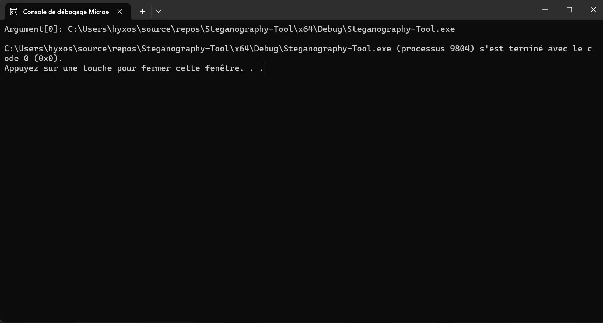

# GTech 1 :
## Manipulation de bits, fichiers binaires et stéganographie BMP

---

  

---

    <picture>
      <source media="(prefers-color-scheme: dark)" srcset="docs/img/img1.png">
      
    </picture>

